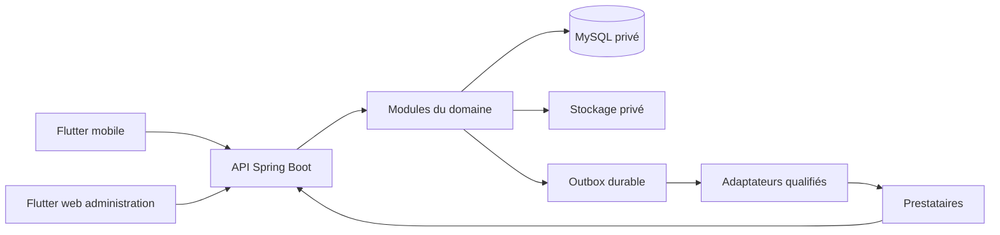

# WAKA — organisation technique minimale

03.10 v1 — 11 octobre 2026. **Réalisé — à relire à la fin du lot autorisé.** Choix de réalisation issus des spécifications ; application non encore compilée.

## O01 — Composants retenus

| Composant | Choix | Responsabilité et limite |
|---|---|---|
| Mobile client/chauffeur | Flutter, Android au lancement ; deux vues dans la même application | Présenter E01–E24 et demander les opérations ; aucun calcul de prix ou droit faisant autorité |
| Administration | Application Flutter web distincte | E25–E29 : vérification, assistance, finance et audit selon droits ; aucun secret inclus dans le code distribué au navigateur |
| Serveur | Spring Boot Java, un processus organisé par modules | API, règles, transactions, autorisation par objet et intégrations ; interfaces internes explicites |
| Données | MySQL Community, une base WAKA par environnement | États, versions, dettes, écritures, idempotence/outbox et contraintes ; accès applicatif limité |
| Documents | Stockage privé piloté par le serveur | Pièces originales et photos contrôlées ; métadonnées en base ; hors ressources publiques |
| Externes | Adaptateurs dédiés paiement/course, abonnement Android, cartes, communication | Aucun appel commercial avant qualification ; résultats inconnus et reprise identifiée |

Flutter web prend en charge des applications interactives dans le navigateur. C'est notre choix pour une administration applicative et pour réutiliser Dart, sans nouveau langage frontend obligatoire. L'accès reste assuré par le serveur et des sessions administratives adaptées ; le choix web ne protège pas les pièces à lui seul. [Documentation Flutter web](https://docs.flutter.dev/platform-integration/web), consultée le 11 octobre 2026.



## O02 — Modules du serveur et dépendances

Sous le package interne `com.waka`, classe de démarrage à la racine ; sous-packages par domaine. Ce nom interne ne déclare aucune propriété d'un domaine Internet. La localisation de la classe principale au-dessus des sous-packages suit le [guide Spring Boot](https://docs.spring.io/spring-boot/reference/using/structuring-your-code.html), consulté le 11 octobre 2026.

| Module | Objets/contrats et responsabilité | Dépendances permises |
|---|---|---|
| identity | Personne, rôles, session ; authentifier, autoriser, révoquer | Noyau technique minimal ; pas finance/mobilité |
| drivers | Dossier, décisions, véhicule, fichiers/photos et validités | identity ; interface d'accès particulier portée par finance |
| mobility | Trajet, versions/arrêts/segments, devis accepté, recherche/proposition, réservation/retenue/preuves | drivers pour admission ; geo pour calcul ; pricing pour devis ; finance via interface orchestration |
| geo | Positions/routage/matching, provenance et plafonds de détour | Adaptateur cartes qualifié ; modèles de lecture minimaux, pas écriture de dette |
| pricing | Grille/version, fractions, arrondis et calculs initiaux/conservés | Fonctions pures ; pas réseau/base/écran comme autorité de prix |
| finance | Paiements, événements, remboursement, dettes, journaux/versements, achats et accès particulier | identity ; pricing ; interface referrals pour éligibilité ; adaptateurs prestataires |
| referrals | Rattachement/window/bonus candidat et éligibilité par personne | identity et événements de fin payée ; pas appel bancaire direct |
| notifications | Outbox/messages et livraison | Interfaces de lecture nécessaires ; pas modification directe de réservation ou gains |
| operations | Administration, assistance, incidents, audit, procédures et droits des données | Opérations publiques des domaines et permissions ; pas accès libre à tous repositories |

Les modules possèdent leurs données et exposent des opérations ; aucun module ne modifie directement les tables/repositories d'un autre. Les références entre objets ne nécessitent pas des services réseau distincts. Les commandes coordonnées mobilité/finance sont gérées par une façade applicative explicite et des interfaces : éviter le cycle de dépendances Java `mobility ↔ finance`. Les événements durables mettent à jour des projections ou déclenchent un travail, sans remplacer les verrous d'une acceptation immédiate.

La consultation d'admission appelle un service de lecture combinant dossier et accès ; le module drivers ne dépend pas des détails des achats. Les fonctions de finance reçoivent un contexte de réservation immuable via l'orchestrateur, sans appeler les repositories mobility. Les règles d'accès et de finance s'expliquent avant leur code ; contrôler les dépendances au fur et à mesure.

## O03 — Organisation à matérialiser à 04.01

```text
WAKA/
  README.md
  .gitignore
  .editorconfig
  .vscode/extensions.json
  backend/
    README.md
    src/main/java/com/waka/
    src/main/resources/db/migration/
    src/test/java/com/waka/
  apps/
    mobile/README.md
    admin/README.md
  docs/
    README.md
    specifications/       règles, parcours, écrans, données, états, API, droits
    architecture/         choix et frontières
    decisions/            décisions datées et cas encore ouverts
  tests/README.md          stratégie des contrôles utiles
  tools/README.md          outils du dépôt, sans secret
```

04.01 crée ces dossiers et leurs repères ; `pom.xml`, classes Java et application Flutter seront créés à 04.02/04.04. Aucun projet vide exécutable ou donnée de démonstration n'est ajouté pour annoncer un démarrage. Les fichiers `.gitkeep` sont uniquement des marqueurs de dossier Git.

À la création Flutter : `lib/core` pour réseau, reprise et session ; `lib/features/<fonction>` pour vue, modèle de présentation et repository ; `test` pour contrôles de comportement. Séparer présentation et accès aux données, conformément au [guide d'architecture Flutter](https://docs.flutter.dev/app-architecture/guide). L'état métier officiel reste serveur ; un repository peut garder le dernier état connu et son heure. Ajouter une couche de cas d'usage seulement lorsque le besoin le justifie. Les modèles partagés entre applications ne seront extraits que lorsqu'une duplication réelle existe.

À la création serveur : par module, `api` (entrée contrôlée), `application` (commande/orchestration), `domain` (règles), `infrastructure` (persistance/adaptateurs). Créer seulement les classes nécessaires au point réalisé. L'architecture propose des frontières sans obliger à écrire quatre classes pour chaque simple lecture.

## O04 — Transactions et travail externe

1. L'API contrôle session, fonction et objet ; normalise demande et clé de reprise.
2. Les calculs routiers nécessaires se font hors transaction, avec provenance et version.
3. Garde véhicule → trajets/recherche selon ordre stable : état et échéances, capacité/exclusivité sur tous engagements, projections entre versions ; acceptation fige prix/commission, retient places et ajoute événement outbox.
4. Un worker du même serveur transmet l'instruction identifiée après commit. Aucune bibliothèque de file de messages ou serveur Redis n'est obligatoire au pilote.
5. Réponse/notification authentifiée, dédoublonnée, rapprochée : conversion de retenue seulement active ; sinon encaissement et restitution. Aucun succès tardif ne reprend une place.
6. Fin payée : parts/éligibilité établies, dettes et journal équilibré ; après remboursement, compensation cumulée depuis l'instantané. Rien n'annonce un versement avant sa preuve externe.

MySQL sert de stockage durable et d'outbox au départ. Le worker réclame les tâches avec concurrence maîtrisée, récupère les tâches interrompues et conserve la référence externe. L'absence de réponse impose rapprochement ; « au moins une livraison possible » n'autorise jamais plusieurs débits. Ces mécanismes feront l'objet de vrais tests lorsque codés.

## O05 — Environnements et secrets

Développement local avec cas fictifs ; essais isolés et comptes d'essai qualifiés ; production séparée lorsque prête. Aucun environnement local ne contacte automatiquement production. Configuration non secrète versionnée ; secrets externes hors Git/coffre approprié et injectés à l'exécution, jamais dans l'application Flutter ou les fichiers d'administration web.

Stockage local privé et simulation contrôlée ne prouvent pas disponibilité d'un prestataire. La collecte réelle exige droits, validités/qualification et stockage privé vérifiés. Le dossier modèle `WAKA_confidentiel` ne sera pas copié dans le dépôt. Les clés de chiffrement et sauvegardes restent séparées ; restauration et récupération hors PC à établir avant les fonctions qui en dépendent.

## O06 — Versions, coût et vérifications à venir

| Outil | Version conservée depuis la préparation | Prochain contrôle réel |
|---|---|---|
| Flutter/Dart | 3.47.6 / 3.13.5 | Création/analyse/compilation Android à 04.04 ; navigateur lors de création admin |
| JDK Temurin | 21.0.12.1+1 | Maven du vrai projet à 04.02 |
| Maven | 3.10.0 | Résolution/construction serveur à 04.02 |
| Spring Boot | 4.1.1, choix documentaire | Version du pom fixée et téléchargée à 04.02, pas installation globale |
| MySQL Community | 8.4.11 LTS local préparé | Driver/migrations/TLS/droits et base vide à 04.03 |

Les exigences officielles Spring Boot 4.1.1 autorisent Java 17–26 et Maven ≥3.6.3 ; Java 21 et Maven 3.10.0 restent compatibles au niveau de ces prérequis. Les dépendances de WAKA seront vérifiées en construction, sans déduire qu'elles ont déjà été résolues. [Exigences Spring Boot](https://docs.spring.io/spring-boot/system-requirements.html), consultées le 11 octobre 2026.

**Coût de ce point : 0 F**, aucun outil, licence ou service ajouté. Les ressources futures et frais d'exploitation restent dans le budget prudent (reference detaillee conservee hors du depot) : licence gratuite n'est pas hébergement gratuit. Les prestataires, production, reprise et garanties de conservation restent à qualifier avant engagement. Pas de nouveau choix de bibliothèque de paiement, cartes ou d'authentification par commodité.

## O07 — Lecture et contrôle de couverture

[Fiches E01–E29](../specifications/WAKA_fiches_ecrans.md) → [contrats API](../specifications/WAKA_contrats_api.md) → [transitions T01–T40](../specifications/WAKA_etats_et_transitions.md) → [objets D01–D42](../specifications/WAKA_modele_donnees.md), avec [droits A01–A07](../specifications/WAKA_acces_et_conservation.md). Chaque commande conserve ces quatre liens lors de son implémentation. Les cas ouverts sont consignés avant code : achat avant première course/essai, première interruption et déclencheurs, prolongation/remboursement combinés, contrats, droits/conservation.

Lecture dans le dossier documentaire : `code outputs/WAKA_architecture_minimale.md`, Ctrl+Maj+V. Le schéma est informatif ; aucun système commercial ne tourne par sa seule rédaction. Suite autorisée : 04.01, arborescence du dépôt existant ; arrêt ensuite.
